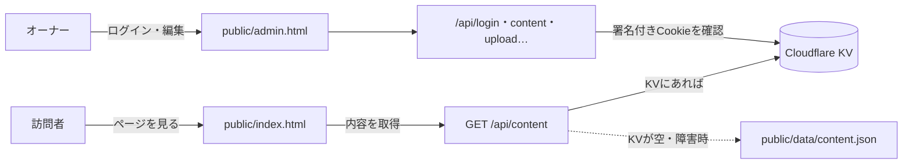

# shop-cms-starter

小さなお店向けの「1ページのホームページ」と「オーナーが自分で更新できる管理画面」を、
Cloudflare Pages / Pages Functions / KV だけで動かすテンプレートです。

- 月額の運用費はほぼ0円です（Cloudflare の無料枠に収まります）。
- サーバーの保守はいりません。
- 認証・保存・パスワード照合は、すべてサーバー側で行います。

個人事業「ちいさなお店のホームページ屋」で、実際に納品・公開しているサイトの仕組みを、
案件ごとの情報を抜いて汎用化したものです。

- 動いている例（架空のネイルサロン）: https://salon-lueur.pages.dev/
- 自社サイト（同じ仕組みで運用中）: https://machino-hp-ana.pages.dev/

このリポジトリの写真は、差し替え用の仮画像です。

## なぜ作ったか

小さなお店がホームページを持たない理由は、だいたい次の2つです。

- 月々の費用がかかる。
- 自分で更新できない。

WordPress は高機能ですが、サーバー代・更新作業・セキュリティ対応がずっとついて回ります。
予約サイトのページだけで済ませると、写真やお知らせを自由に出せません。

そこで、次の3つを満たすことを目標にしました。

- 表示するのは静的ファイルだけにして、速く安く動かす。
- 内容の変更は、管理画面から行う。HTMLは触らない。
- 動く部分（ログイン・保存・画像）は、小さな関数に分けてサーバー側に置く。

## しくみ



- **HTMLは文字を持たない。** `index.html` には `data-cms="hero.title"` のような目印だけを置きます。
  読み込み時に `/api/content` から内容を取ってきて、目印の場所に差し込みます。
  オーナーが内容を変えても、HTMLを書き換える必要はありません。
- **KVが読めなくても真っ白にならない。** API が 404 やエラーを返したときは、
  同梱の `data/content.json` に切り替えて表示します。
- **管理画面は1枚のHTML。** タブごとのフォームから、文章・写真・セクションの並び順を変えられます。

## 構成

```
public/                 配信するファイル（そのまま Pages に載る）
├── index.html          サイト本体
├── admin.html          管理画面
├── data/content.json   全内容の初期値（KV 障害時の予備も兼ねる）
└── images/             同梱の写真（仮画像）
functions/              Pages Functions（TypeScript）
├── _lib.ts             パスワード・セッション・画像判定の共通処理
├── api/                login / logout / session / changepw / content / images / upload / delete-image
└── up/[name].ts        アップロードされた画像の配信
tests/                  node:test のテスト（KV はメモリで代用）
scripts/hash-password.mjs  初期パスワードのハッシュを作る
```

## セキュリティで気をつけたこと

| 対策 | 内容 |
|---|---|
| パスワードの保存 | 平文は持ちません。PBKDF2-SHA256（10万回）のハッシュだけを保存します。ソルトは導入先ごとに環境変数で変えます |
| セッション | 「有効期限.HMAC署名」の形の値を Cookie（HttpOnly / Secure / SameSite=Strict）に入れます。期限を書き換えると署名が合わなくなります |
| 比較の時間差 | 署名とハッシュは、かかる時間が中身によって変わらない方法で比べます |
| 総当たり | ログインに失敗したら、0.7秒待ってから応答します |
| 画像アップロード | 申告された種類は信用しません。ファイル先頭のバイトで JPEG / PNG / GIF / WebP かを判定し、4MBまでに制限します |
| 画像の配信 | ファイル名を `^[\w.-]+$` に限定してパスのたどりを防ぎ、`nosniff` を付けて返します |
| 壊れたデータ | 必須セクションが欠けた内容や大きすぎる内容は、保存の前に断ります |

これらの動きは `tests/` で確かめています。たとえば次のようなケースです。

- 改ざんしたセッションで入れないこと。
- 画像を名乗った HTML を弾くこと。
- パスワードを変えたら、古いパスワードでは入れなくなること。

## 開発

Node.js 22.18 以上が必要です。TypeScript をそのまま実行できる Node の機能を使っているので、ビルドの手順はありません。

```bash
npm install
npm run check        # 型検査（tsc）とテスト（node --test）
```

GitHub Actions でも、push のたびに同じ検査を走らせています。

ローカルでサイトと API を動かすには、次のようにします。

```bash
cp .dev.vars.example .dev.vars   # 値を入れる（ADMIN_PW_HASH は下のコマンドで作る）
node scripts/hash-password.mjs <初期パスワード> <PW_SALT と同じ値>
npm run dev                      # http://localhost:8788 （KV はローカルのものが使われる）
```

## 公開手順

```bash
npx wrangler login
npx wrangler kv namespace create CMS        # 出てきた id を wrangler.toml に貼る
npx wrangler pages deploy public            # 初回でプロジェクトが作られる

# 秘密の値はリポジトリに書かず、Cloudflare 側に入れる
npx wrangler pages secret put SESSION_SECRET
npx wrangler pages secret put PW_SALT
npx wrangler pages secret put ADMIN_PW_HASH

npx wrangler pages deploy public            # 秘密の値を反映させるため、もう一度
```

公開後は `/admin.html` に初期パスワードでログインし、「設定」タブで変更してもらいます。

### はまりやすい点

Pages の設定画面で、KV の紐付け（binding 名 `CMS`）が正しい名前空間を指しているか確かめてください。
食い違っていると、「保存したのに反映されない」状態になります。

KV への書き込みは、必ず管理画面（API）を通します。
`wrangler kv key put` で直接書くと、どの名前空間に入ったか分からなくなる事故が起きやすいためです。

## 導入先ごとに変えるところ

- `public/index.html` のデザインとセクション。
- `public/data/content.json` の初期内容。
- `functions/api/images.ts` の同梱画像の一覧。
- `functions/api/content.ts` の必須セクション。

## ライセンス

MIT
